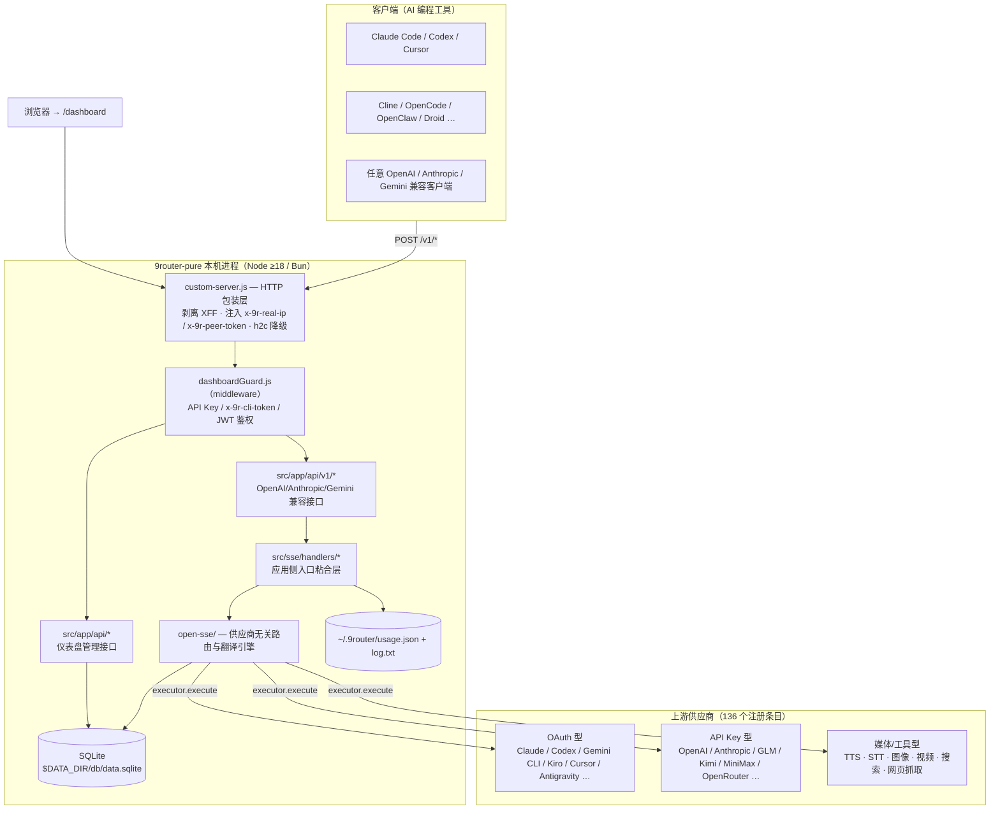
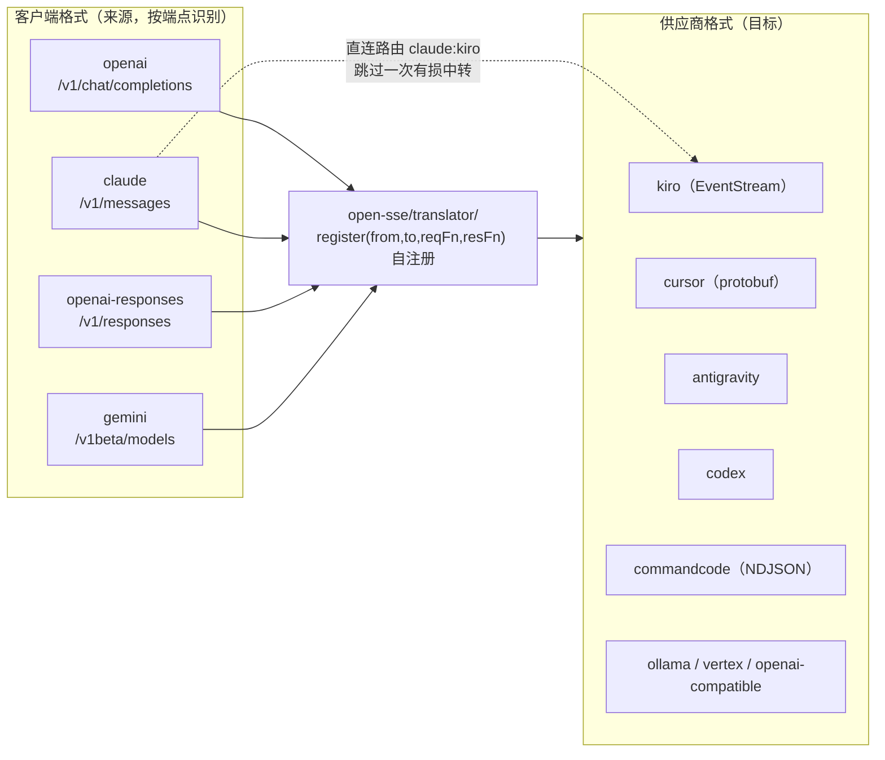
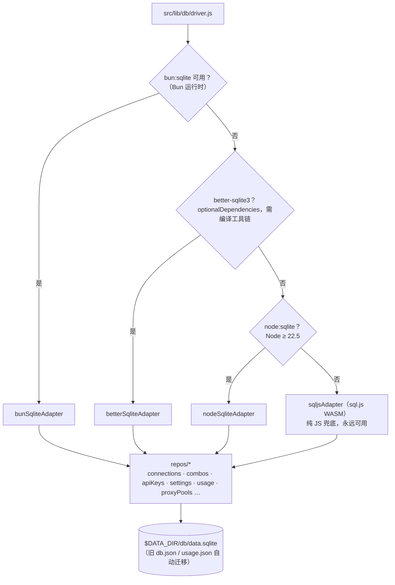
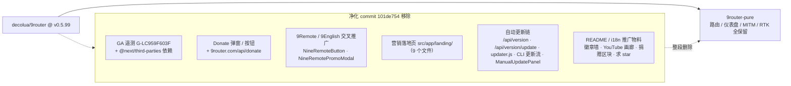

<div align="center">

> [English](./README_en.md) | **简体中文**


# 9router-pure — 9Router 纯净版（去广告 / 去遥测 / 去自动更新）

**同一个本地 AI 路由网关：一个 OpenAI 兼容端点接入 130+ 供应商 —— 但没有任何遥测、捐赠弹窗、交叉推广和自动更新。**


</div>

---

## 它解决什么问题

上游 [decolua/9router](https://github.com/decolua/9router) 本身是一个优秀的本地 AI 网关：把 Claude Code、Codex、Cursor、Cline、OpenCode 等工具统一接到一个 `http://localhost:20128/v1` 端点，背后是 130+ 供应商、格式互译、组合模型回退与 RTK token 压缩。

但上游构建里内嵌了：

- **Google Analytics**（`G-LC959F603F`，经 `@next/third-parties` 注入）
- **捐赠弹窗与上报端点**（`9router.com/api/donate`）
- **9Remote / 9English 交叉推广**（侧栏外链 + 弹窗组件）
- **一整页营销落地页**（`src/app/landing/`）
- **自动更新链**（向 npm registry 拉版本号、`/api/version/update` 自安装、detached 更新进程）

**9router-pure 做的事情只有一件**：把上面这些全部删掉，其余功能原样保留。这不是 GitHub fork，而是基于上游 `v0.5.99`（2026-10-08）源码 + 一个净化 commit（`101de754`）的独立仓库，**仅供学习与代码参考**。完整差异见 [🔀 vs 上游](#-vs-上游)。

> 验证方式：`grep -rni "G-LC959F603F\|third-parties\|donateUrl\|NineRemote" src cli open-sse` —— 零命中。

---

## ✨ 功能

### 纯净版特有

- **零遥测**：无 GA、无捐赠上报、无版本检查外呼（npm registry 自检已移除）
- **零推广**：无捐赠弹窗、无 9Remote/9English 推广位、无营销落地页（`/` 直接进 `/dashboard`）
- **零自动更新**：不会自己下载/替换二进制，升级由你 `git pull` 决定

### 继承自上游（未动一刀）

- **统一端点**：`/v1/chat/completions`、`/v1/messages`（Anthropic）、`/v1/responses`、`/v1/embeddings`、`/v1/images/generations`、`/v1/audio/*`、`/v1/search`、`/v1/web/fetch`、`/v1/videos/*`、`/v1beta/models`（Gemini）
- **格式互译引擎**（`open-sse/translator/`）：以 openai 为中间格式；`claude:kiro` 等脆弱对有直连路由
- **Combos**：多模型按 `fallback`/`fusion` 策略串联；Cursor/Claude 预设别名（`cu/*`、`cc/*`）
- **RTK Token 节省器**：`tool_result` 就地压缩（12 个过滤器），fail-open
- **账号级回退 + OAuth 自动刷新**（`open-sse/services/tokenRefresh*`、`accountFallback.js`）
- **MITM 录制代理**（`src/mitm/`）：Antigravity / Kiro 等 IDE 流量接管
- **SQLite 持久化**：驱动回退链 `bun:sqlite → better-sqlite3 → node:sqlite → sql.js`
- **仪表盘**：供应商/组合/配额/用量/CLI 工具/代理池/翻译器调试台，登录由 JWT cookie 保护

---

## 🚀 快速开始

### 方式一：给 AI Agent 的一键提示词

````markdown
帮我部署 9router-pure（https://github.com/RayMorTwinkle/9router-pure），步骤：
1. `git clone` 该仓库到本地并进入目录
2. `cp .env.example .env`，把 JWT_SECRET 改为一个长随机串、INITIAL_PASSWORD 改为强密码（默认 123456 不安全）
3. `npm install && npm run build`（需要 Node ≥ 18，推荐 22；无编译工具链也没关系，SQLite 会落到 sql.js）
4. `node custom-server.js --port 20128` 启动（注意：仓库里 `npm start` 固定走 20127 端口）
5. 打开 http://localhost:20128/dashboard 用 INITIAL_PASSWORD 登录
6. 在 Providers 页连接一个供应商（如 Kiro / OpenCode Free 免注册），在 Endpoint & Key 页生成 API Key
7. 把我的 CLI 工具指向 `http://localhost:20128/v1`（Anthropic 工具用 `/v1/messages` 兼容端点，模型名形如 `cc/claude-sonnet-5`）
````

### 方式二：面向人类用户

```bash
git clone git@github.com:RayMorTwinkle/9router-pure.git
cd 9router-pure
cp .env.example .env          # 必改：JWT_SECRET / INITIAL_PASSWORD
npm install
npm run build                 # next build --webpack + postbuild 拷贝 standalone 资产
node custom-server.js --port 20128
# 打开 http://localhost:20128/dashboard
```

Docker（自行构建，不要拉 `decolua/9router` 镜像——那是上游版）：

```bash
docker build -t 9router-pure .
docker run -d --name 9router-pure -p 20128:20128 \
  --env-file .env -v 9router-data:/app/data 9router-pure
```

> **环境要求**：Node ≥ 18（`node:sqlite` 需 ≥ 22.5，否则自动回退 `sql.js`）；或 Bun（`npm run dev:bun` 等脚本已就绪）。`npm install -g 9router` 装到的是**上游包**，不是本仓库。

---

## 🖥️ 使用

### 端口与入口

| 入口 | 地址 | 说明 |
|---|---|---|
| 仪表盘 | `http://localhost:20128/dashboard` | JWT cookie（`auth_token`）登录；`/` 自动重定向 |
| 兼容 API | `http://localhost:20128/v1/*` | 重写至 `/api/v1/*`，见 `next.config.mjs` |
| 健康检查 | `http://localhost:20128/api/health` | 公开接口 |
| 仓库内 dev/start | 端口 `20127` | `npm run dev` / `npm start` 固定 `--port 20127` |

### 客户端接入

| 客户端 | 配置项 | 值 |
|---|---|---|
| OpenAI 兼容工具 | `base_url` | `http://localhost:20128/v1` |
| Claude Code 等 Anthropic 工具 | `ANTHROPIC_BASE_URL` | `http://localhost:20128`（走 `/v1/messages`） |
| API Key | `Authorization: Bearer …` / `x-api-key` / `x-goog-api-key` / `?key=` | 仪表盘 → Endpoint & Key 生成 |
| 模型名 | `model` | `provider/model`，如 `cc/claude-sonnet-5`；combo 名直接可用 |

### 关键环境变量（`.env.example` 全量契约）

| 变量 | 作用 |
|---|---|
| `JWT_SECRET` | **必填**，签发 `auth_token` cookie |
| `INITIAL_PASSWORD` | **必填**，首次登录密码（上游默认 `123456`，务必改） |
| `DATA_DIR` | 数据目录，默认 `~/.9router`（Windows：`%APPDATA%\9router`） |
| `PORT` / `HOSTNAME` | 监听地址；Docker 默认 `20128` / `0.0.0.0` |
| `API_KEY_SECRET` / `MACHINE_ID_SALT` | API Key 存储哈希 / `x-9r-cli-token` 的机器 ID 盐 |
| `REQUIRE_API_KEY` / `AUTH_COOKIE_SECURE` | `/v1` 强制鉴权 / cookie Secure 标志 |
| `HTTP(S)_PROXY` / `ALL_PROXY` / `NO_PROXY` | 上游出网代理（`open-sse/utils/proxyFetch.js` 全局 patch fetch） |
| `CLOUD_URL` / `NEXT_PUBLIC_CLOUD_URL` | 上游官方云端地址，仅用于识别 CLI 工具已配置的端点；本仓库不含云同步后端，可留空 |
| `SEARXNG_URL` | 内置免鉴权网页搜索供应商的自托管端点 |

---

## 🏗️ 架构

### 系统总览



### 一次聊天请求的完整生命周期

```mermaid
sequenceDiagram
  participant Tool as AI 工具（如 Claude Code）
  participant CS as custom-server.js
  participant GD as dashboardGuard（proxy）
  participant RT as /api/v1/* 路由
  participant CH as src/sse/handlers/chat.js
  participant CC as open-sse/handlers/chatCore.js
  participant EX as executors/&lt;provider&gt;.js
  participant UP as 上游供应商

  Tool->>CS: POST /v1/chat/completions（SSE）
  CS->>CS: 剥离 X-Forwarded-For；按 TCP 对端注入 x-9r-real-ip + x-9r-peer-token
  CS->>GD: 包装后的请求
  GD->>GD: 校验 API Key / x-9r-cli-token / 本机回环
  GD->>RT: 放行（/v1/* 重写为 /api/v1/*）
  RT->>CH: handleChat()
  CH->>CH: per-key 访问控制 → combo 展开（fallback / fusion）→ 账号轮询
  CH->>CC: chatCore
  CC->>CC: parseModel → RTK 就地压缩 tool_result → translateRequest
  CC->>EX: execute()（失败重试 / token 刷新 / 账号回退）
  EX->>UP: 供应商原生协议请求
  UP-->>EX: SSE 流
  EX-->>CC: 供应商格式 chunks
  CC-->>Tool: translateResponse → 客户端格式 SSE
```

### 翻译引擎：以 openai 为中间格式，脆弱对走直连



### SQLite 驱动回退链



### 相对上游的净化面



---

## 📂 目录结构

```text
9router-pure/
├── custom-server.js          # Next 服务器包装层：真实 IP 注入、XFF 剥离、h2c→HTTP/1.1 降级
├── next.config.mjs           # /v1/* → /api/v1/* 重写（另有 /codex、/responses 别名）
├── Dockerfile                # node:22-alpine 多阶段；EXPOSE 20128；CMD node custom-server.js
├── src/
│   ├── dashboardGuard.js     # middleware：API Key / x-9r-cli-token / JWT / 仅本机路由白名单
│   ├── app/api/              # v1 兼容接口 + 仪表盘管理接口（auth/providers/combos/usage/oauth/mitm…）
│   ├── app/(dashboard)/      # 仪表盘页面（endpoint/providers/combos/usage/quota/token-saver/
│   │                         #   cli-tools/mitm/proxy-pools/skills/translator/console-log…）
│   ├── sse/handlers/         # 应用侧入口：chat / embeddings / tts / stt / search / video…
│   ├── lib/db/               # SQLite 层：driver.js 回退链 + adapters/ + repos/ + migrations/
│   └── mitm/                 # MITM 录制代理（cert / dns / handlers / server.js / winElevated.js）
├── open-sse/                 # 供应商无关的路由/翻译引擎（可独立使用）
│   ├── handlers/             # chatCore / imageGenerationCore / embeddingsCore / videoCore…
│   ├── translator/           # request|response/<from>-to-<to>.js 自注册；schema/ + concerns/
│   ├── executors/            # 30 个按供应商的专用执行器；default.js 通吃 OpenAI 兼容上游
│   ├── providers/registry/   # 136 个注册条目；index.js 为自动生成，勿手改
│   ├── rtk/                  # Token 节省器：filters/ 12 个压缩器 + headroom/caveman/ponytail
│   └── services/             # model / combo / accountFallback / tokenRefresh / usage…
├── cli/                      # `9router` CLI 启动器包（独立版本号；connect / show / xai video 子命令）
├── skills/                   # 可直接粘贴给 AI Agent 的 SKILL.md 技能包（链接指向上游 raw）
├── tests/                    # vitest 独立包；~938 通过基线，见 tests/__baseline__/known-fails.txt
├── docs/ gitbook/            # 上游架构文档与 GitBook 站点源码
└── i18n/                     # 上游多语言 README（纯净化后保留）
```

---

## 🔧 技术细节

- **版本**：根包 `9router-app@0.5.99`；`cli/` 独立发包为 `9router@0.5.99`（本仓库不发布 npm 包）
- **栈**：Next.js 16.1（webpack 构建）+ React 19 + Tailwind 4，纯 ESM JavaScript，无 TypeScript
- **端口**：CLI 常量 `DEFAULT_PORT = 20128`（`cli/cli.js`）、`UPDATER_CONFIG.appPort = 20128`；仓库脚本 `npm run dev` / `npm start` 固定 `--port 20127`；生产建议 `node custom-server.js --port 20128`
- **持久化**：`DATA_DIR` → 默认 `~/.9router`（Win：`%APPDATA%\9router`）；库文件 `$DATA_DIR/db/data.sqlite`；`usage.json` / `log.txt` 固定 `~/.9router`；旧版 `db.json` / `disabledModels.json` / `request-details.json` 自动迁移
- **鉴权链**：`/v1*` 走 Bearer / `x-api-key` / `x-goog-api-key` / `?key=`；`x-9r-cli-token` = `getConsistentMachineId("9r-cli-auth")`，放行本机 CLI；仪表盘 `auth_token` JWT cookie；`ALWAYS_PROTECTED` 含 `/api/shutdown`、`/api/version/shutdown`；`LOCAL_ONLY_PATHS`（spawn 子进程/读本机密钥的路由）要求回环 + 鉴权
- **真实 IP**：`custom-server.js` monkey-patch `http.createServer`，以 TCP `remoteAddress` 为准注入 `x-9r-real-ip` + 随机 `x-9r-peer-token`，仅当对端是回环代理时才采纳转发头（置 `x-9r-via-proxy`）
- **模型寻址**：`provider/model` 形式（`parseModel`）；别名如 `cc/*`（Claude 预设）、`cu/*`（Cursor 预设）；combo 名可当 model 直接用，`comboStrategies` 支持 `fallback` / `fusion` / per-combo `judgeModel` / `comboStickyRoundRobinLimit`
- **RTK**：`open-sse/rtk/filters/` 内含 `gitDiff / gitLog / gitStatus / grep / ls / tree / find / readNumbered / dedupLog / buildOutput / searchList / smartTruncate`；就地改写 `tool_result`，跳过 `is_error`/`status:"error"`，任何异常 fail-open 不动请求体；`cursor` 供应商在翻译**前**执行（其 translator 会改写该结构），其余在翻译后
- **翻译器清单**：请求侧 `antigravity/claude/gemini→openai`、`openai→claude/commandcode/cursor/gemini/kiro/ollama/vertex`、`claude→kiro`（直连）、`openai-responses`；响应侧对应反向 + `commandcode/cursor/gemini/kiro/ollama→openai`、`openai→antigravity/claude`
- **测试**：`tests/` 为独立 vitest 包（不挂根 `npm test`）；基线 ~938 过 / ~64 红（`tests/__baseline__/known-fails.txt` 有目录，`verify-no-regression.mjs` 判定回归）；`real/*.test.js` 需真实凭据

---

## 🔀 vs 上游

净化全部落在 commit [`101de754`](https://github.com/RayMorTwinkle/9router-pure/commit/101de7549ea27aac8d42740a7180d30a1e5547fd)（37 个文件，-4156 行）：

| 类别 | 移除内容 | 证据（文件 / 符号） |
|---|---|---|
| 遥测 | Google Analytics `G-LC959F603F` + `@next/third-parties` | `src/app/layout.js`、`package.json` |
| 捐赠 | Donate 弹窗/按钮 + 上报端点 | `src/shared/components/DonateModal.js`（删）、`9router.com/api/donate` |
| 交叉推广 | 9Remote / 9English | `NineRemoteButton.js`、`NineRemotePromoModal.js`（删）、`Sidebar.js` 外链 |
| 营销页 | 落地页整目录 | `src/app/landing/`（8 个组件 + `page.js`，删） |
| 自动更新 | npm registry 版本检查 + 自安装 | `src/app/api/version/route.js`、`version/update/route.js`（删）；`src/lib/updater/updater.js`（删，235 行 detached 进程）；`cli/cli.js` 更新分支；`ManualUpdatePanel`；`UPDATER_CONFIG` 瘦身为 `{ appPort: 20128 }` |
| 推广物料 | README / i18n 徽章墙（shields、trendshift、starchart、contrib.rocks）、YouTube 画廊、捐赠/赞助区块、OmniRoute 推广、求 star 文案 | `README*.md`、`i18n/*.md` |

**保留**（功能性数据源，非遥测）：`models.dev` 模型能力目录同步、`raw.githubusercontent.com` 的 changelog 拉取、`api.anthropic.com/mcp-registry` MCP 市场；`/api/version/shutdown` 关机接口；`machineId` / `x-9r-cli-token` 本机鉴权；`disableEssentialTelemetry`（该项是**关闭下游工具遥测**用的配置）。

**同步基线**：上游 `v0.5.99`（2026-10-08，commit `ce4460ef`）。

---

## ❓ 常见问题

**Q：`npm install -g 9router` 装到的是这个纯净版吗？**
A：不是。npm 上的 `9router` 是上游发布的包（含遥测与自动更新）。纯净版只能从本仓库源码构建或自打 Docker 镜像。仓库内的 `cli/` 可用 `npm run cli:pack` 本地打包，但未发布到 npm。

**Q：没有自动更新，怎么升级？**
A：`git pull` 后 `npm install && npm run build` 重启即可。本仓库会不定期跟随上游 release 同步，并始终保持「净化 commit 叠在上游 tag 之上」的结构。

**Q：它还会向外部"打电话"吗？**
A：没有遥测/捐赠/版本检查类外呼。仍存在的出网行为都是**你主动触发的功能**：上游供应商 API 调用、`models.dev` 目录同步、changelog 拉取、MCP registry，以及可选的 tunnel（cloudflared/tailscale）与 headroom 代理——均可在仪表盘关闭或不启用。

**Q：为什么 `npm start` 起来不是 20128？**
A：仓库脚本写的是 `node custom-server.js --port 20127`（命令行 flag 优先于 `PORT` 环境变量）。要 20128 就显式执行 `node custom-server.js --port 20128`，或用 Dockerfile（`EXPOSE 20128`，`CMD node custom-server.js` 读取 `PORT`）。

**Q：`dashboardGuard` 里的 `/api/cloud` 为什么没找到路由？**
A：那是上游遗留的死配置项；官方云同步后端不在开源仓库内，`cloudEnabled` / `CLOUD_URL` 仅用于识别 CLI 工具已配置的端点。

---

## ⚠️ 注意事项

- 本仓库**仅供学习与代码参考**，不用于任何商业或生产用途，与上游作者无任何关联。
- 与上游无 GitHub fork 关系；如需比对差异，直接 diff 净化 commit 即可。
- `INITIAL_PASSWORD` 上游默认值为 `123456`，部署前**必须**在 `.env` 中改掉，并设置 `JWT_SECRET`。
- 使用者须自行遵守所在国家/地区法律法规及各 AI 供应商的服务条款，**本仓库作者不承担任何责任**。
- 若上游作者或任何权利人认为本仓库构成侵权，请通过 GitHub Issues 或 `cyb2831173936@163.com` 联系，我会尽快删除处理。

---

## 📄 License

MIT License — 见 [LICENSE](LICENSE)。上游项目为 MIT，本仓库沿用同一协议并保留原版权信息。

## 🙏 致谢

- **[decolua/9router](https://github.com/decolua/9router)** — 上游项目（MIT），本仓库全部功能代码来自上游。
- 上游自身致谢的生态项目：CLIProxyAPI / RTK / Caveman / Ponytail / Headroom 等。

<div align="center">
<sub>9router-pure · 同一个路由器，只是安静了。</sub>
</div>
