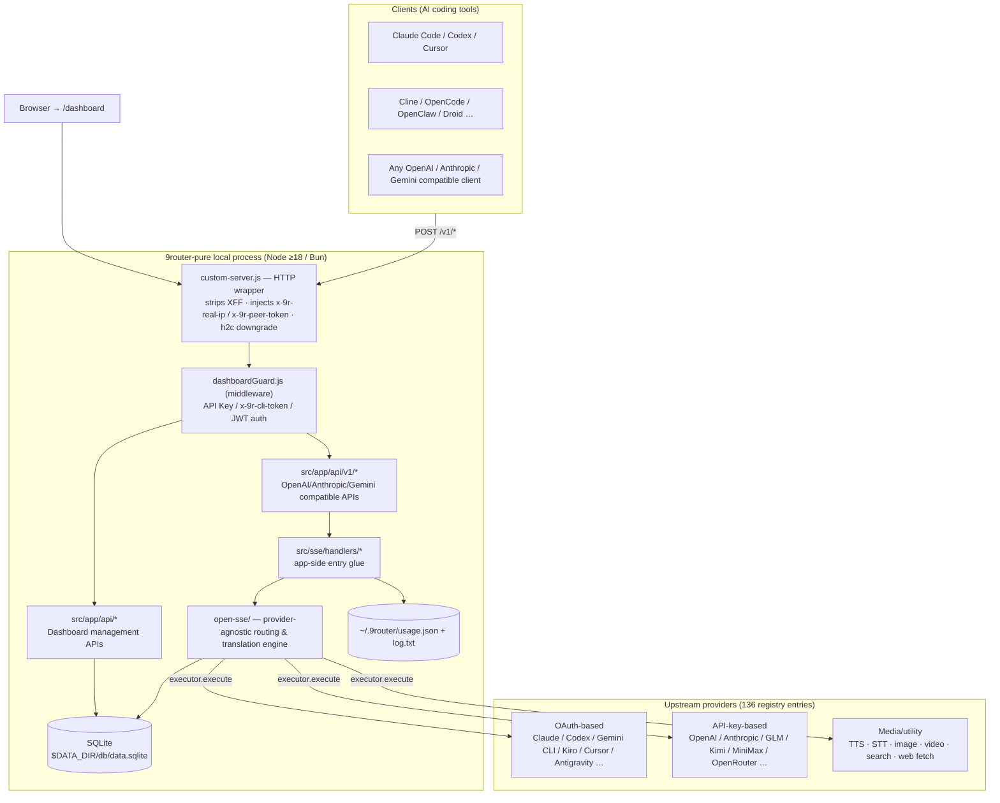
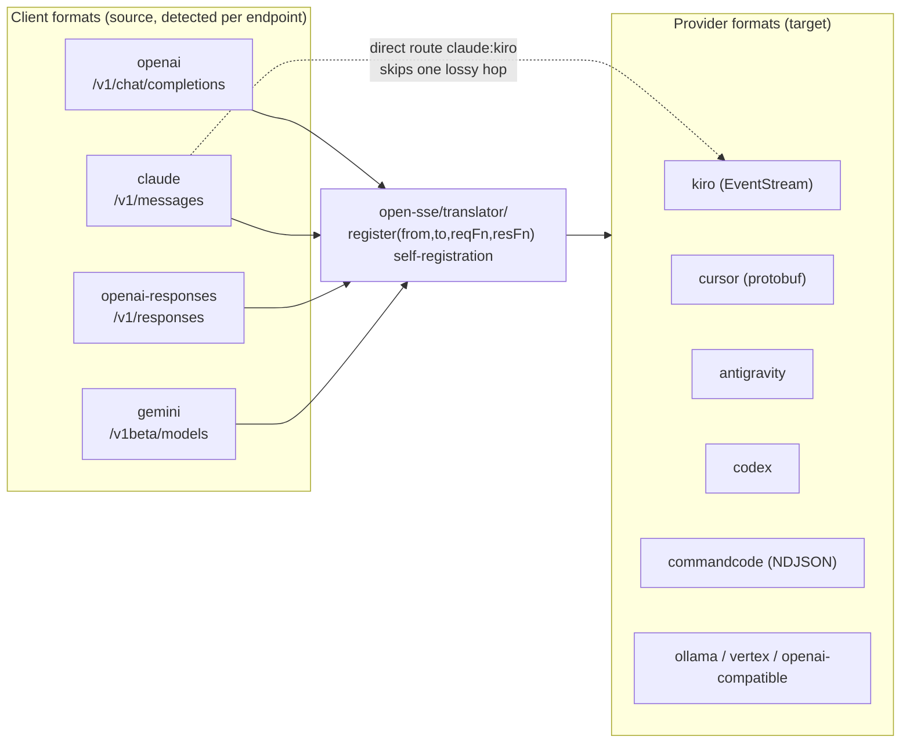
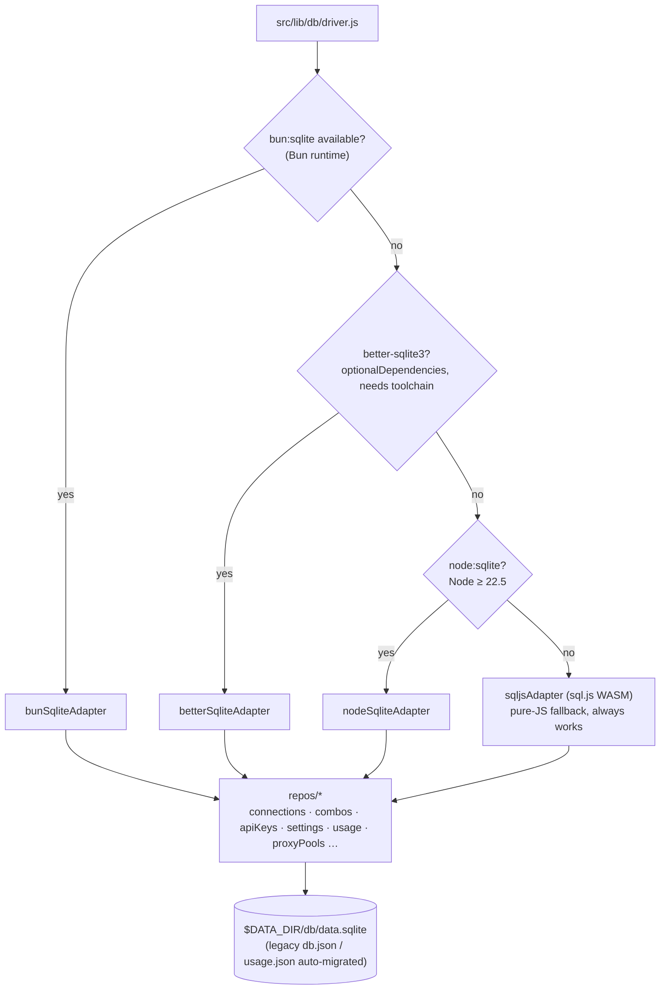
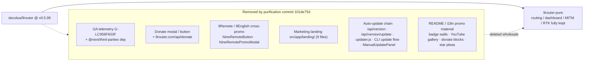

<div align="center">

> **English** | [简体中文](./README.md)


# 9router-pure — 9Router, de-bloated (no ads / no telemetry / no auto-update)

**The same local AI routing gateway: one OpenAI-compatible endpoint fronting 130+ providers — minus all telemetry, donation popups, cross-promotion, and self-updating.**


</div>

---

## Why it exists

Upstream [decolua/9router](https://github.com/decolua/9router) is an excellent local AI gateway: it unifies Claude Code, Codex, Cursor, Cline, OpenCode and friends behind a single `http://localhost:20128/v1` endpoint, backed by 130+ providers, format translation, combo fallback, and RTK token compression.

But the upstream build embeds:

- **Google Analytics** (`G-LC959F603F`, injected via `@next/third-parties`)
- **A donation modal and reporting endpoint** (`9router.com/api/donate`)
- **9Remote / 9English cross-promotion** (sidebar links + a promo modal)
- **An entire marketing landing page** (`src/app/landing/`)
- **A self-update chain** (npm registry version checks, `/api/version/update` self-install, a detached updater process)

**9router-pure does exactly one thing**: removes all of the above while keeping every feature intact. This is not a GitHub fork — it's an independent repo built from upstream `v0.5.99` (2026-10-08) sources plus one purification commit (`101de754`), provided **for learning and code reference only**. Full diff: [🔀 vs Upstream](#-vs-upstream).

> Verify it yourself: `grep -rni "G-LC959F603F\|third-parties\|donateUrl\|NineRemote" src cli open-sse` — zero hits.

---

## ✨ Features

### Specific to the pure build

- **Zero telemetry**: no GA, no donation reporting, no outbound version checks (npm registry self-check removed)
- **Zero promotion**: no donation modal, no 9Remote/9English slots, no marketing landing page (`/` goes straight to `/dashboard`)
- **Zero auto-update**: it never downloads or replaces its own binaries — upgrades are your `git pull` decision

### Inherited from upstream (untouched)

- **Unified endpoint**: `/v1/chat/completions`, `/v1/messages` (Anthropic), `/v1/responses`, `/v1/embeddings`, `/v1/images/generations`, `/v1/audio/*`, `/v1/search`, `/v1/web/fetch`, `/v1/videos/*`, `/v1beta/models` (Gemini)
- **Format translation engine** (`open-sse/translator/`): pivots through `openai` as the intermediate format; fragile pairs like `claude:kiro` get direct routes
- **Combos**: chain multiple models with `fallback`/`fusion` strategies; Cursor/Claude preset aliases (`cu/*`, `cc/*`)
- **RTK token saver**: in-place `tool_result` compression (12 filters), fail-open
- **Account-level fallback + automatic OAuth refresh** (`open-sse/services/tokenRefresh*`, `accountFallback.js`)
- **MITM recording proxy** (`src/mitm/`): traffic takeover for IDEs such as Antigravity / Kiro
- **SQLite persistence**: driver fallback chain `bun:sqlite → better-sqlite3 → node:sqlite → sql.js`
- **Dashboard**: providers / combos / quotas / usage / CLI tools / proxy pools / translator playground; login protected by a JWT cookie

---

## 🚀 Quick Start

### Option 1: One-shot prompt for an AI Agent

````markdown
Deploy 9router-pure (https://github.com/RayMorTwinkle/9router-pure) for me:
1. `git clone` the repo and cd into it
2. `cp .env.example .env`, then set JWT_SECRET to a long random string and INITIAL_PASSWORD to a strong password (the default 123456 is unsafe)
3. `npm install && npm run build` (requires Node ≥ 18, 22 recommended; no build toolchain is fine — SQLite falls back to sql.js)
4. Start with `node custom-server.js --port 20128` (note: the repo's `npm start` is pinned to port 20127)
5. Open http://localhost:20128/dashboard and log in with INITIAL_PASSWORD
6. On the Providers page connect a provider (e.g. Kiro / OpenCode Free need no signup), then generate an API Key on the Endpoint & Key page
7. Point my CLI tool at `http://localhost:20128/v1` (Anthropic-style tools use the `/v1/messages` compatible endpoint; model names look like `cc/claude-sonnet-5`)
````

### Option 2: For humans

```bash
git clone git@github.com:RayMorTwinkle/9router-pure.git
cd 9router-pure
cp .env.example .env          # must edit: JWT_SECRET / INITIAL_PASSWORD
npm install
npm run build                 # next build --webpack + postbuild copies standalone assets
node custom-server.js --port 20128
# open http://localhost:20128/dashboard
```

Docker (build it yourself — do **not** pull `decolua/9router`; that's the upstream image):

```bash
docker build -t 9router-pure .
docker run -d --name 9router-pure -p 20128:20128 \
  --env-file .env -v 9router-data:/app/data 9router-pure
```

> **Requirements**: Node ≥ 18 (`node:sqlite` needs ≥ 22.5, otherwise it falls back to `sql.js`); or Bun (`npm run dev:bun` etc. are ready). `npm install -g 9router` installs the **upstream package**, not this repo.

---

## 🖥️ Usage

### Ports & entry points

| Entry | Address | Notes |
|---|---|---|
| Dashboard | `http://localhost:20128/dashboard` | JWT cookie (`auth_token`) login; `/` auto-redirects |
| Compatible API | `http://localhost:20128/v1/*` | Rewritten to `/api/v1/*`, see `next.config.mjs` |
| Health check | `http://localhost:20128/api/health` | Public endpoint |
| In-repo dev/start | port `20127` | `npm run dev` / `npm start` are pinned to `--port 20127` |

### Client configuration

| Client | Setting | Value |
|---|---|---|
| OpenAI-compatible tools | `base_url` | `http://localhost:20128/v1` |
| Anthropic tools (e.g. Claude Code) | `ANTHROPIC_BASE_URL` | `http://localhost:20128` (serves `/v1/messages`) |
| API key | `Authorization: Bearer …` / `x-api-key` / `x-goog-api-key` / `?key=` | Generate on Dashboard → Endpoint & Key |
| Model name | `model` | `provider/model`, e.g. `cc/claude-sonnet-5`; combo names work directly |

### Key environment variables (full contract in `.env.example`)

| Variable | Purpose |
|---|---|
| `JWT_SECRET` | **Required** — signs the `auth_token` cookie |
| `INITIAL_PASSWORD` | **Required** — first login password (upstream default `123456`; change it) |
| `DATA_DIR` | Data directory, default `~/.9router` (Windows: `%APPDATA%\9router`) |
| `PORT` / `HOSTNAME` | Listen address; Docker defaults to `20128` / `0.0.0.0` |
| `API_KEY_SECRET` / `MACHINE_ID_SALT` | API-key storage hash / machine-ID salt for `x-9r-cli-token` |
| `REQUIRE_API_KEY` / `AUTH_COOKIE_SECURE` | Enforce auth on `/v1` / set the cookie Secure flag |
| `HTTP(S)_PROXY` / `ALL_PROXY` / `NO_PROXY` | Outbound proxy for upstream calls (`open-sse/utils/proxyFetch.js` patches global fetch) |
| `CLOUD_URL` / `NEXT_PUBLIC_CLOUD_URL` | Upstream's official cloud address, only used to recognize endpoints already configured by CLI tools; this repo ships no cloud-sync backend — safe to leave empty |
| `SEARXNG_URL` | Self-hosted endpoint for the built-in auth-free web-search provider |

---

## 🏗️ Architecture

### System overview



### Lifecycle of one chat request

```mermaid
sequenceDiagram
  participant Tool as AI tool (e.g. Claude Code)
  participant CS as custom-server.js
  participant GD as dashboardGuard (proxy)
  participant RT as /api/v1/* route
  participant CH as src/sse/handlers/chat.js
  participant CC as open-sse/handlers/chatCore.js
  participant EX as executors/&lt;provider&gt;.js
  participant UP as Upstream provider

  Tool->>CS: POST /v1/chat/completions (SSE)
  CS->>CS: strip X-Forwarded-For; inject x-9r-real-ip + x-9r-peer-token from TCP peer
  CS->>GD: wrapped request
  GD->>GD: verify API Key / x-9r-cli-token / loopback
  GD->>RT: pass through (/v1/* rewritten to /api/v1/*)
  RT->>CH: handleChat()
  CH->>CH: per-key ACL → combo expansion (fallback / fusion) → account rotation
  CH->>CC: chatCore
  CC->>CC: parseModel → RTK in-place tool_result compression → translateRequest
  CC->>EX: execute() (retry / token refresh / account fallback)
  EX->>UP: provider-native protocol request
  UP-->>EX: SSE stream
  EX-->>CC: provider-format chunks
  CC-->>Tool: translateResponse → client-format SSE
```

### Translation engine: `openai` as pivot, direct routes for fragile pairs



### SQLite driver fallback chain



### What the purification removed



---

## 📂 Project layout

```text
9router-pure/
├── custom-server.js          # Next server wrapper: real-IP injection, XFF strip, h2c→HTTP/1.1 downgrade
├── next.config.mjs           # /v1/* → /api/v1/* rewrites (plus /codex, /responses aliases)
├── Dockerfile                # node:22-alpine multi-stage; EXPOSE 20128; CMD node custom-server.js
├── src/
│   ├── dashboardGuard.js     # middleware: API Key / x-9r-cli-token / JWT / local-only route allowlist
│   ├── app/api/              # v1 compatible APIs + dashboard management APIs (auth/providers/combos/usage/oauth/mitm…)
│   ├── app/(dashboard)/      # dashboard pages (endpoint/providers/combos/usage/quota/token-saver/
│   │                         #   cli-tools/mitm/proxy-pools/skills/translator/console-log…)
│   ├── sse/handlers/         # app-side entry: chat / embeddings / tts / stt / search / video…
│   ├── lib/db/               # SQLite layer: driver.js fallback chain + adapters/ + repos/ + migrations/
│   └── mitm/                 # MITM recording proxy (cert / dns / handlers / server.js / winElevated.js)
├── open-sse/                 # provider-agnostic routing/translation engine (usable standalone)
│   ├── handlers/             # chatCore / imageGenerationCore / embeddingsCore / videoCore…
│   ├── translator/           # request|response/<from>-to-<to>.js self-registering; schema/ + concerns/
│   ├── executors/            # 30 provider-specific executors; default.js covers any OpenAI-compatible upstream
│   ├── providers/registry/   # 136 registry entries; index.js is auto-generated — do not hand-edit
│   ├── rtk/                  # token saver: filters/ 12 compressors + headroom/caveman/ponytail
│   └── services/             # model / combo / accountFallback / tokenRefresh / usage…
├── cli/                      # `9router` CLI launcher package (own version; connect / show / xai video subcommands)
├── skills/                   # SKILL.md skill packs you can paste to an AI Agent (links point to upstream raw)
├── tests/                    # standalone vitest package; ~938-pass baseline, see tests/__baseline__/known-fails.txt
├── docs/ gitbook/            # upstream architecture docs and GitBook site sources
└── i18n/                     # upstream localized READMEs (kept after purification)
```

---

## 🔧 Technical notes

- **Versioning**: root package `9router-app@0.5.99`; `cli/` publishes separately as `9router@0.5.99` (this repo does not publish to npm)
- **Stack**: Next.js 16.1 (webpack build) + React 19 + Tailwind 4; plain ESM JavaScript, no TypeScript
- **Ports**: CLI constant `DEFAULT_PORT = 20128` (`cli/cli.js`), `UPDATER_CONFIG.appPort = 20128`; repo scripts `npm run dev` / `npm start` are pinned to `--port 20127`; for production prefer `node custom-server.js --port 20128`
- **Persistence**: `DATA_DIR` → default `~/.9router` (Win: `%APPDATA%\9router`); database at `$DATA_DIR/db/data.sqlite`; `usage.json` / `log.txt` stay under `~/.9router`; legacy `db.json` / `disabledModels.json` / `request-details.json` are auto-migrated
- **Auth chain**: `/v1*` accepts Bearer / `x-api-key` / `x-goog-api-key` / `?key=`; `x-9r-cli-token` = `getConsistentMachineId("9r-cli-auth")` lets local CLI through; the dashboard uses the `auth_token` JWT cookie; `ALWAYS_PROTECTED` includes `/api/shutdown` and `/api/version/shutdown`; `LOCAL_ONLY_PATHS` (routes that spawn subprocesses or read local secrets) require loopback + auth
- **Real IP**: `custom-server.js` monkey-patches `http.createServer`, injecting `x-9r-real-ip` + a random `x-9r-peer-token` from the TCP `remoteAddress`; forwarding headers are only honored when the peer is a loopback proxy (marked via `x-9r-via-proxy`)
- **Model addressing**: `provider/model` form (`parseModel`); aliases like `cc/*` (Claude presets) and `cu/*` (Cursor presets); combo names work as model names; `comboStrategies` supports `fallback` / `fusion` / per-combo `judgeModel` / `comboStickyRoundRobinLimit`
- **RTK**: `open-sse/rtk/filters/` contains `gitDiff / gitLog / gitStatus / grep / ls / tree / find / readNumbered / dedupLog / buildOutput / searchList / smartTruncate`; rewrites `tool_result` in place, skips `is_error`/`status:"error"`, and any failure fails open leaving the body untouched; for `cursor` it runs **before** translation (its translator rewrites that structure), for everything else after
- **Translator inventory**: request side `antigravity/claude/gemini→openai`, `openai→claude/commandcode/cursor/gemini/kiro/ollama/vertex`, `claude→kiro` (direct), `openai-responses`; response side mirrors them plus `commandcode/cursor/gemini/kiro/ollama→openai`, `openai→antigravity/claude`
- **Tests**: `tests/` is a standalone vitest package (not wired to root `npm test`); baseline ~938 pass / ~64 red (`tests/__baseline__/known-fails.txt` catalogs them; `verify-no-regression.mjs` judges regressions); `real/*.test.js` need live credentials

---

## 🔀 vs Upstream

All purification lives in commit [`101de754`](https://github.com/RayMorTwinkle/9router-pure/commit/101de7549ea27aac8d42740a7180d30a1e5547fd) (37 files, −4156 lines):

| Category | Removed | Evidence (files / symbols) |
|---|---|---|
| Telemetry | Google Analytics `G-LC959F603F` + `@next/third-parties` | `src/app/layout.js`, `package.json` |
| Donation | Donate modal/button + reporting endpoint | `src/shared/components/DonateModal.js` (deleted), `9router.com/api/donate` |
| Cross-promo | 9Remote / 9English | `NineRemoteButton.js`, `NineRemotePromoModal.js` (deleted), `Sidebar.js` links |
| Marketing page | entire landing directory | `src/app/landing/` (8 components + `page.js`, deleted) |
| Auto-update | npm registry version check + self-install | `src/app/api/version/route.js`, `version/update/route.js` (deleted); `src/lib/updater/updater.js` (deleted, 235-line detached process); `cli/cli.js` update branch; `ManualUpdatePanel`; `UPDATER_CONFIG` slimmed to `{ appPort: 20128 }` |
| Promo material | README / i18n badge walls (shields, trendshift, starchart, contrib.rocks), YouTube gallery, donate/sponsor blocks, OmniRoute promo, star pleas | `README*.md`, `i18n/*.md` |

**Kept** (functional data sources, not telemetry): `models.dev` model-capability catalog sync, `raw.githubusercontent.com` changelog fetch, `api.anthropic.com/mcp-registry` MCP marketplace; the `/api/version/shutdown` endpoint; `machineId` / `x-9r-cli-token` local auth; `disableEssentialTelemetry` (that option **disables downstream-tool telemetry** — it's a feature, not a leak).

**Sync baseline**: upstream `v0.5.99` (2026-10-08, commit `ce4460ef`).

---

## ❓ FAQ

**Q: Does `npm install -g 9router` install this pure build?**
A: No. `9router` on npm is the upstream package (with telemetry and auto-update). The pure build only exists as source in this repo or as a self-built Docker image. The in-repo `cli/` can be packed locally with `npm run cli:pack`, but it is not published to npm.

**Q: With no auto-update, how do I upgrade?**
A: `git pull`, then `npm install && npm run build` and restart. This repo will periodically follow upstream releases, always keeping the "purification commit on top of an upstream tag" structure.

**Q: Does it still "phone home"?**
A: There are no telemetry/donation/version-check calls. The outbound traffic that remains is **functionality you trigger**: upstream provider API calls, `models.dev` catalog sync, changelog fetch, MCP registry — plus optional tunnel (cloudflared/tailscale) and headroom proxy, all disableable or simply not enabled in the dashboard.

**Q: Why doesn't `npm start` come up on 20128?**
A: The repo script is `node custom-server.js --port 20127` (the CLI flag wins over the `PORT` env var). For 20128 run `node custom-server.js --port 20128` explicitly, or use the Dockerfile (`EXPOSE 20128`, `CMD node custom-server.js` reads `PORT`).

**Q: Why can't I find a route for `/api/cloud` referenced in `dashboardGuard`?**
A: That's a dead config entry left over from upstream; the official cloud-sync backend is not part of the open-source repo — `cloudEnabled` / `CLOUD_URL` only serve to recognize endpoints already configured by CLI tools.

---

## ⚠️ Notes

- This repo is **for learning and code reference only** — not for any commercial or production use, and not affiliated with the upstream author.
- It has no GitHub fork relationship with upstream; to diff, simply inspect the purification commit.
- Upstream's default `INITIAL_PASSWORD` is `123456` — **you must** change it in `.env` and set `JWT_SECRET` before deploying.
- Users must comply with the laws/regulations of their jurisdiction and each AI provider's terms of service; **the author of this repo assumes no liability**.
- If the upstream author or any rights holder believes this repo is infringing, please reach out via GitHub Issues or `cyb2831173936@163.com` and it will be taken down promptly.

---

## 📄 License

MIT License — see [LICENSE](LICENSE). Upstream is MIT; this repo keeps the same license and the original copyright notice.

## 🙏 Credits

- **[decolua/9router](https://github.com/decolua/9router)** — the upstream project (MIT); all functional code in this repo comes from upstream.
- Ecosystem projects credited by upstream itself: CLIProxyAPI / RTK / Caveman / Ponytail / Headroom, among others.

<div align="center">
<sub>9router-pure · Same router, just quieter.</sub>
</div>
